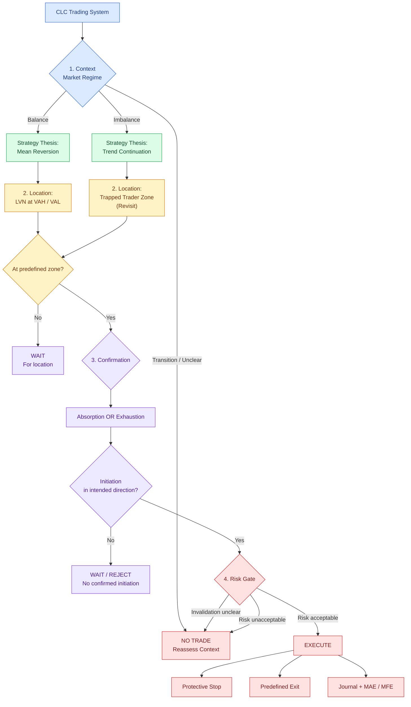

# Orderflow — CLC Trading Decision Tree

> Research framework for GC / NQ intraday trading (5–30 minutes).  
> **CLC:** Context → Strategy Thesis → Location → Confirmation → Risk & Execution.

中文：本仓库用于研究可复现的订单流决策规则。**Strategy Thesis 由 Context 决定；Trapped Trader Zone 是 Location，而不是一个独立 Setup。** 所有信号均为待验证假设，不代表已证明存在正期望。

## CLC Decision Tree v1.1

## Strategy Matrix / 策略矩阵

| Context | Strategy Thesis | Location | Confirmation |
| --- | --- | --- | --- |
| Balance | Mean Reversion | LVN at VAH / VAL | (Absorption OR Exhaustion) + Initiation |
| Imbalance | Trend Continuation | Trapped Trader Zone (revisit) | (Absorption OR Exhaustion) + Initiation |

## Decision Rules / 决策规则

| Layer | Question / 判断 | If not satisfied / 不满足 |
| --- | --- | --- |
| Context | Is the market regime sufficiently clear? / 市场状态是否清晰？ | No trade |
| Strategy Thesis | Does the selected strategy fit the current Context? / 策略逻辑是否匹配背景？ | No trade |
| Location | Has price returned to a predefined meaningful zone? / 价格是否回到预设位置？ | Wait |
| Confirmation | Did the predefined response and order-flow sequence occur? / 是否出现预设确认？ | Wait or reject |
| Risk | Are invalidation, stop, sizing and exit specified? / 风险边界是否明确？ | No trade |
| Execution | All gates satisfied? / 所有门槛均满足？ | Execute according to plan |

## Definitions / 概念边界

- **Context:** Balance, Imbalance, or Transition/Unclear. Classification requires an explicit timeframe and reproducible rules.
- **Strategy Thesis:** Mean Reversion is the initial default for Balance; Trend Continuation is the initial default for Imbalance. These are research defaults, not universal laws.
- **Location:** Strictly two allowed choices: **Balance → LVN at VAH or VAL**; **Imbalance → Trapped Trader Zone** (wait for price to revisit prior trapped entries). Zone boundaries and identification criteria must be defined before testing.
- **Confirmation:** Both regimes require **(Absorption OR Exhaustion) AND subsequent Initiation** in the intended trade direction. Here *Initiation* means directional aggressive execution accompanied by price progress; precise thresholds, ordering and observation windows remain to be defined and validated.
- **Order Flow Evidence:** Absorption and Exhaustion are alternatives for the first condition, not two simultaneous requirements. Neither alone authorizes entry.
- **Risk:** Protective stop, position size and exit logic are defined before entry. Do not widen risk ad hoc after entry.
- **Validation:** Record all eligible signals, including skipped trades; study costs, MAE/MFE and out-of-sample net expectancy.

> **Research-only:** This decision tree organizes discretionary decision-making. It is not a validated trading strategy or investment recommendation.
